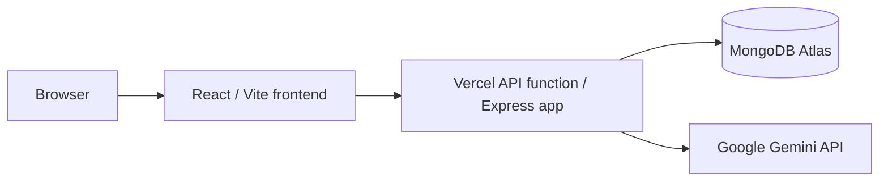

# GT3 Race Control Telemetry

[](https://github.com/AaronNaval/itelect4-project/actions/workflows/ci.yml)

## Local setup

Copy `.env.example` to `.env`, set `JWT_SECRET` to a long random value, and set
`MONGODB_URI` to your local MongoDB or Atlas connection string. The Vite
frontend reads `VITE_API_URL` when it builds, so use the local API address for
development (for this combined project, `http://localhost:4000/api`). Set
`API_PORT` to `4000` and `CORS_ORIGIN` to `http://localhost:5173`. In local development only, the API can start without `JWT_SECRET`
by creating a temporary secret at startup; tokens from that run will stop
working when the API restarts. A working `MONGODB_URI` is still required for
registration and database-backed routes. Start the frontend and API in separate
terminals:

```sh
npm run dev
npm run api
```

Run `npm run seed` once to add the three reference course records required by
the Session 10 API exercise. The script upserts by course code, so it is safe
to run again.

## Race timing desk

The authenticated dashboard at `/dashboard/timing` records driver name, car,
and manually entered lap times (`MM:SS.mmm`) in MongoDB. It displays the
fastest lap, a best-lap leaderboard, and the recent race-control entry log.
This version is a manual timing desk; it does not connect to a car, transponder,
or live telemetry feed.

## AI project review

The protected dashboard page at `/dashboard/ai-review` sends a validated
project description (20–2000 trimmed characters) to `POST /api/ai`. The server
keeps `GEMINI_API_KEY` private, instructs Gemini to treat submitted text as
untrusted data, validates the four-field response with Zod, and limits each
authenticated user to five requests per minute. The response includes a
summary, strengths, improvements, and a readiness value.

Set `GEMINI_API_KEY` in the backend's `.env` for local development and restart
the API. For Vercel, add it as a backend environment variable for Production,
Preview, and Development, then redeploy. Never add the key to a `VITE_`
variable, commit it, or put it in frontend code. If a key has been committed,
revoke it in Google AI Studio and create a replacement.

## API routes

- `GET /api/health` checks the API and MongoDB connection.
- `GET /api/courses` and `GET /api/courses/:code` are public.
- Authenticated `GET /api/timing/laps` lists recent manual timing entries.
- Authenticated `POST /api/timing/laps` records `{ "driverName", "carModel",
  "bestLapTime" }`; the recording user is derived from the token.
- Authenticated `POST /api/ai` accepts `{ "prompt": "..." }` and returns a
  schema-validated project review. It responds with `400` for invalid input,
  `429` when the per-user rate limit is reached, and `502` if Gemini fails or
  returns an invalid response.
- `POST /api/auth/register` accepts `{ "name", "email", "password" }`.
- `POST /api/auth/login` accepts `{ "email", "password" }` and returns a JWT
  and the user profile.
- The Session 10 GitHub repository exercise remains available separately at
  `GET`/`POST /api/submissions` and `GET`/`DELETE /api/submissions/:id`; these
  routes are not the race timing dashboard.

Passwords are stored as bcrypt hashes. Login tokens expire after two hours;
the frontend discards expired persisted tokens and clears the session after a
401 response.

## Vercel deployment

Deploy this project with the frontend and the `api/[...path].js` function in the
same Vercel project. Set these variables in the Vercel environment used by the
deployment:

- `MONGODB_URI`: the Atlas connection string.
- `JWT_SECRET`: a long, unique secret.
- `GEMINI_API_KEY`: a server-only Google AI Studio key for AI reviews.
- `CORS_ORIGIN`: the exact deployed frontend origin, without a trailing slash.
- `VITE_API_URL`: the deployed API base, normally
  `https://your-domain.vercel.app/api`.

Vite embeds `VITE_API_URL` into the frontend bundle at build time. After changing
it (or changing the target environment), redeploy so the frontend is rebuilt.
Set the variables separately for Preview and Production if both are used.

## Release checks

This repository contains the frontend and API together, so one workflow checks
both parts; there is no separate backend repository to run a second workflow
against. Before tagging a release, complete these checks:

1. On the deployed site, open `/api/health` and confirm it returns
   `{"ok":true,"db":true}`.
2. On the deployed frontend, register and log in, record a timing lap, and
   submit one AI review.
3. In the Vercel project, confirm `MONGODB_URI`, `JWT_SECRET`, `CORS_ORIGIN`,
   and `GEMINI_API_KEY` are set for the deployed environment.
4. Confirm `VITE_API_URL` is set to the API base used by this combined app,
   including `/api` and with no trailing slash; redeploy after changing it.
5. Keep `.env.example` limited to variable names with blank values; put actual
   local values only in the ignored `.env`.
6. Run `npm run check:history-secrets`. CI runs the same scan over fetched Git
   history and reports findings without printing their contents.
7. Confirm `npm test` and `npm run build` pass locally.
8. Confirm the latest GitHub Actions run on `main` passes and the CI badge at
   the top of this README is green.
9. Keep this README updated with the app purpose, deployment URLs, local setup,
   architecture, and disclosure of AI assistance used during development.
10. Open the production URL from this README and repeat the live smoke checks.

The production frontend and API URLs are deployment-specific and are not yet
recorded here. Add the actual Vercel URL(s) after deployment; CI does not
pretend local checks prove that a live deployment or its secrets are correct.

### Architecture



### AI-use disclosure

AI coding assistants were used during development. The Gemini feature in the
application reviews only the project description submitted by the user; it
does not inspect source code.

For Atlas, add the deployment's network access entry. If following the class
setup that uses `0.0.0.0/0` for Vercel's changing outbound addresses, restrict
database users and credentials carefully; that setting permits connections
from any IP and is broader than a fixed-IP allowlist.

The health route returns `{ "ok": true, "db": true }` after a successful
database connection and `{ "ok": true, "db": false }` when the API is reachable
but MongoDB is not. API data routes return an explicit database error rather
than pretending the request succeeded.

## Frontend development

`npm run dev` starts the Vite frontend. `npm run api` starts the local Express
API on port `4000`. `npm run api:mock` remains available for the json-server
fixture if needed.

## Testing and CI

Run the backend AI contract tests and the production TypeScript/frontend build
locally with:

```sh
npm test
npm run build
```

GitHub Actions runs both commands on pushes and pull requests targeting `main`,
and can also be started manually from the Actions tab. The tests do not need
MongoDB, a Gemini API key, or any production secrets.

Before tagging a release, verify the live deployment separately: open
`/api/health` and confirm `db` is `true`; exercise registration, login, timing
entry, and one AI review on the deployed frontend; verify the Vercel backend
has `MONGODB_URI`, `JWT_SECRET`, `CORS_ORIGIN`, and `GEMINI_API_KEY`, and the
frontend build has `VITE_API_URL`; then open the live-site link from this
README. Live URLs and Vercel settings are deployment-specific and are not
available to this repository's CI job.
